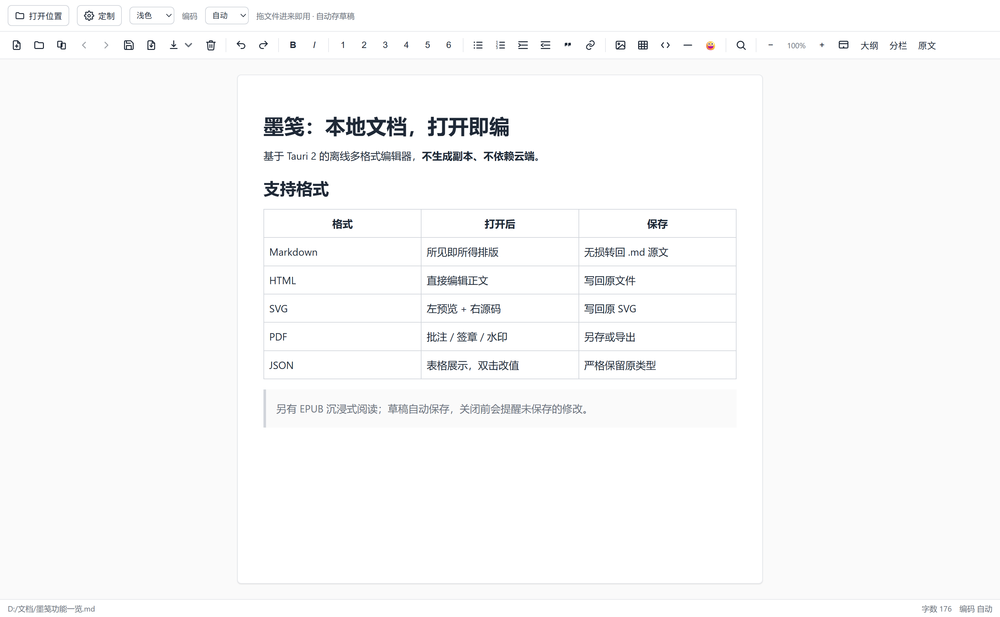
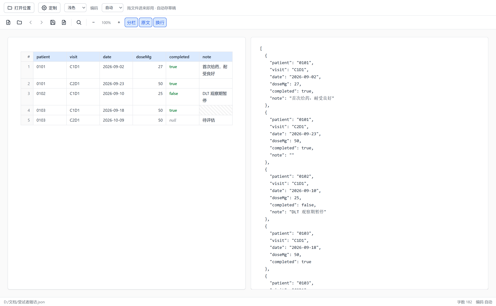

# 墨笺 (Mojian)

> 一个在本机打开、编辑、保存文件的桌面工具。不联网、不上传，文件还在你原来的位置。

**当前版本：1.1.1**

## ✨ 功能特性

墨笺适合经常和这些文件打交道的人：**Markdown、HTML、PDF、EPUB、JSON、各种纯文本**。

-   **一个窗口，多个文件**：每个文件一个标签，切换时各自的内容、滚动位置、未保存状态互不干扰；重启后会按上次的顺序和位置重新打开。
-   **所见即所得**：写 Markdown / HTML 时直接看到排版效果，保存后仍是原来的 `.md` / `.html` 源文件。
-   **PDF 不止能看**：查找、批注、签章、加水印、旋转、合并、拆分、导出图片都可以。
-   **读书与改数据**：EPUB 保留出版社排版、可按章浏览和查找；JSON 可以像表格一样双击改值，右边还能对照原文。
-   **纯文本不挑格式**：`.txt` / `.log` / `.csv` / `.py` 等直接改，原编码、BOM、换行方式按原样写回；未知后缀的文本也能打开。
-   **本地优先**：所有处理在本机完成，不依赖云端，也没有账号。





## 🚀 快速开始

1. 到 [Releases 页面](https://github.com/highwindmx/mojian/releases) 下载最新版：
   -   Windows：`.msi` 安装器，或 `.zip` 便携版（解压后双击 `mojian.exe`，不用安装）
   -   macOS：`.dmg`；Linux：`.deb` / `.AppImage`
2. 把文件**拖进窗口**，或点「打开」选择文件（可以一次选多个）。
3. 改完按 `Ctrl+S` 保存；想保留原件就点「另存副本」。

如果 Windows 10 提示缺少 WebView2，装一下「Microsoft Edge WebView2 Runtime」即可；Windows 11 已自带。

## 📖 使用说明对照表

| 我想做的事 | 怎么做 |
| --- | --- |
| 打开文件 | 拖进窗口，或点「打开」；可多选，每个文件一个标签 |
| 保存到原文件 | `Ctrl+S`，保存后文件格式和内容保持原样 |
| 另存一份 | 点「另存副本」→ 选路径；右侧箭头可先选编码 / BOM 再存 |
| 撤销 / 重做 | `Ctrl+Z` / `Ctrl+Y` |
| 查找替换 | `Ctrl+F` |
| 切换标签 | 点标签，或 `Ctrl+Tab`；`Ctrl+W` 关闭当前标签 |
| 收藏 / 排序标签 | 在标签上点右键；收藏夹按钮在顶栏「设置」右侧 |
| 改文本编码 | 顶栏编码下拉切换后，当前文件会按新编码重新读取 |
| 自定义工具栏 | 顶栏「设置」→「工具栏」，按自己的习惯增删、排序按钮 |

### 各类型文件怎么打开

| 文件 | 打开后是什么样 | 怎么保存 |
| --- | --- | --- |
| `.md` / `.html` | 所见即所得编辑区 | `Ctrl+S` 写回原文件 |
| `.svg` | 左边预览、右边源码 | `Ctrl+S` 写回原文件 |
| `.pdf` | 查看、批注、签章、水印等工具 | 另存为 / 导出 |
| `.epub` | 像读书一样，保留原排版 | 只读 |
| `.json` | 左边表格改值、右边原文对照 | `Ctrl+S` 写回原文件 |
| `.txt` / `.log` / `.csv` 等 | 全屏原文编辑 | `Ctrl+S` 按原编码写回 |
| 未知后缀文件 | 判断是文本才可编辑 | `Ctrl+S` 写回原文件 |

## 💻 系统要求

-   Windows 10 / 11；macOS、Linux 也能构建运行。
-   Windows 10 需要 WebView2 运行时，Windows 11 已内置。
-   文件关联注册（双击文件直接打开）目前仅 Windows 支持，且需自己在系统设置里确认默认应用。

## 🛠 构建与运行（开发者）

只需 Rust 工具链，**不需要 npm / Node**：

```bash
cd src-tauri
cargo build --release
```

产物在 `src-tauri/target/release/mojian.exe`。要打 MSI / NSIS 安装器才需要额外装 Tauri CLI（`cargo install tauri-cli --version '^2'`），细节见 [BUILD.md](./BUILD.md)。

## 🧱 技术栈（开发者）

| 层 | 技术 |
| --- | --- |
| 界面 | 原生 HTML / CSS / JS，零构建；离线自带 marked、turndown、pdf.js、KaTeX、reveal.js 等 |
| 程序 | Rust + Tauri 2，负责文件读写、系统对话框、拖放和 Windows 文件关联 |

## 📁 目录结构（开发者）

```text
mojian/
├── src/               # 界面与前端逻辑（vendor/ 为离线第三方库）
├── src-tauri/         # Rust 程序、配置、图标
├── docs/              # 截图和架构设计
├── examples/          # 示例文件
├── tools/             # 验证与图标生成脚本
├── .github/workflows/ # 多平台自动构建（含 Windows 便携版 ZIP）
├── BUILD.md           # 构建细节
└── CHANGELOG.md       # 版本记录
```

## ⚠️ 已知限制

-   **保存会覆盖原文件**：重要文件请先备份，或用「另存副本」。
-   **未保存内容不会在重启后恢复**：关闭时选「不保存」，默认会在系统临时目录留一份副本，可在「设置 → 其他」关掉这个行为。
-   **Markdown 极复杂嵌套**可能无法 100% 还原；JSON 只能改已有值，要增删字段请在右侧原文里改。
-   **PDF 签章是画进页面的图片**，不是具有法律效力的电子签名，也不能在 Acrobat 里当注释删除。
-   **PDF / EPUB 切到别的标签会关闭视图**，切回时重新打开；有未保存的旋转 / 签章会先询问你。

## 📄 许可证

本项目基于 [GNU General Public License v3.0](LICENSE) 开源，版权 © 2026 highwindmx。

你可以自由使用、修改和分发本项目的代码，但任何衍生作品必须以相同的 GPL-3.0 许可证发布。

Powered by WorkBuddy
